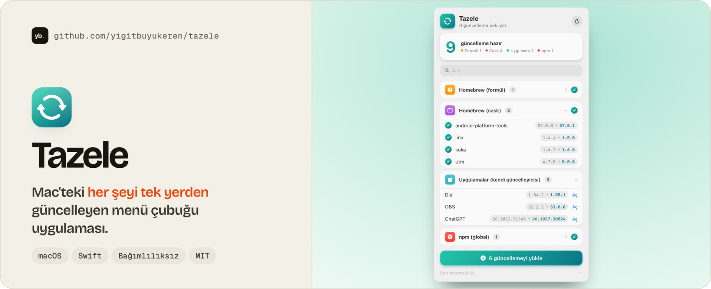

<a href="https://github.com/yigitbuyukeren/tazele">
  <picture>
    <source media="(prefers-color-scheme: dark)" srcset="docs/banner-dark.jpg">
    
  </picture>
</a>

# Tazele

Mac'teki her şeyi tek yerden güncelleyen uygulama; menü çubuğunda ve pencerede çalışır. Homebrew (formül, cask ve kendi güncelleyen cask'ler), App Store, npm, rustup, RubyGems, pipx/uv, Oh My Zsh ve kendi güncelleyicisi olan (Sparkle) uygulamaları tarar; seçtiklerini canlı günlükle günceller. Yeniden başlatma gerektirmeyen macOS güncellemeleri kurulabilir; yeniden başlatma isteyenler için açık onaydan sonra "Kur ve yeniden başlat" ya da Sistem Ayarları kullanılır. Alt çubuktaki kilit düğmesiyle Touch ID veya parola bir kez verilir; yönetici gerektiren adımlar boşta 5 dakika yeniden sormaz (kalıcı sudo kuralı yazılmaz). Kurulu olmayan araçlar atlanır. Arayüz Türkçe ve İngilizce, sistem diline göre seçilir.

App Store güncellemeleri için `mas` aracı root sahibi ve kullanıcı tarafından değiştirilemeyen bir konumda olmalıdır. Homebrew ile kurulan kullanıcıya ait `mas` güncellemeleri listeler; yüklemek için App Store açılır.

> Durum: MVP. Arka planda yalnızca kontrol eder, güncellemeleri sen onaylayınca yükler; henüz imzalı/noter onaylı bir sürüm yok, kaynaktan derlenir.

```bash
swift build && swift test
.build/debug/Tazele    # pencere + menü çubuğu
scripts/build-app.sh   # build/Tazele.app (simge, dil dosyaları dahil)
python3 scripts/check-strings.py   # çeviri tablosu denetimi
```

## Desteklenen kaynaklar

| Kaynak | Davranış |
|---|---|
| Homebrew | Formül ve cask güncellemeleri; kendi güncelleyicisi olan cask’leri de kontrol eder |
| App Store | `mas` ile listeler; güvenli yönetici kurulumu yoksa yükleme için App Store’u açar |
| Sparkle uygulamaları | Kendi güncelleme akışlarını kontrol eder; seçilen güncellemeleri yükler |
| Geliştirici araçları | npm, rustup, RubyGems, pipx ve uv |
| Oh My Zsh | Kuruluysa güncellemeleri kontrol eder |
| macOS | Güncellemeleri listeler; yeniden başlatma isteyen kurulum ayrı onay gerektirir |

Kurulu olmayan kaynaklar atlanır. Listeyi kontrol etmek güncellemeleri yüklemez; yükleme kullanıcı seçiminden sonra başlar.

## Gereksinimler ve kullanım

- macOS 15 veya üzeri ve Swift 6 içeren Xcode / Command Line Tools.
- Yukarıdaki komutlarla derle, `.build/debug/Tazele` veya `build/Tazele.app` üzerinden aç.
- Kaynakların taranmasını bekle, yüklemek istediğin güncellemeleri seç ve güncellemeyi başlat.
- Yönetici yetkisi gereken adımlar için alt çubuktaki kilit düğmesini kullan. Canlı günlükten ilerlemeyi izle.
- Uygulama yönetilen paket araçlarını kullanır; bu araçların eksik olması ilgili kaynağın atlanmasına yol açar.

## Doğrulama ve sınırlar

5 Kasım 2026’da `swift build`, `swift test` ve `python3 scripts/check-strings.py` çalıştırıldı: **149 test başarılı**, çeviri tablosunda **133 anahtar, 0 eksik, 0 kullanılmayan**. Bu sonuçlar tüm üçüncü taraf uygulamaların gerçek güncellemesinin denendiği anlamına gelmez.

Proje MVP aşamasında; imzalı ve noter onaylı dağıtım paketi yok. Kaynaktan derleme gerekir. [Geliştirme planı](docs/PLAN.md) depoda tutulur.

## English

Tazele is a macOS menu-bar and window app that brings updates from Homebrew, the App Store, Sparkle apps, npm, rustup, RubyGems, pipx/uv, Oh My Zsh and macOS into one list. Background checks only list updates; installation starts after you choose it. Restarting macOS updates require separate confirmation. The UI follows the system language (Turkish or English).

Build with `swift build && swift test`, then run `.build/debug/Tazele`, or create an app bundle with `scripts/build-app.sh`. It is an MVP distributed as source, with no developer-signed or notarized release yet. On 5 Nov 2026, the build, 149 tests and the translation-table check passed. These checks do not establish that every third-party app update works on a real system.

## Lisans

MIT
